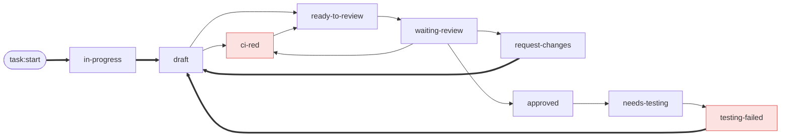

# Dix états, et ce qui les réveille

Pas de <code>todo</code>, et c'est un choix : un ticket non commencé n'a pas de tâche. <code>waiting</code> met le polling en pause depuis n'importe où ; un merge ferme la tâche depuis n'importe quel état.

<b>La règle d'or :</b> les flèches épaisses sont des commandes tapées — <code>task:start</code>, puis <code>/pablo-commit-and-pr</code> pour <b>toutes celles qui entrent dans <code>draft</code></b>. Les autres viennent du poller.
Je décide quand une tâche me quitte ; la machine s'occupe du reste.

<!--
Ce qui se passe à l'entrée :
- in-progress : branche + worktree, task-analyst une fois, + script de startup du projet
- draft : commit, push, draft PR
- ci-red : ci-analyst sur les checks en échec et leurs logs
- ready-to-review : passe la PR en ready sur GitHub, puis retombe en waiting-review
- waiting-review : rien, là où une tâche attend des humains
- approved : nouveau depuis l'article — enchaîne sur needs-testing, ou reste là si le projet n'a pas de QA
- needs-testing : stocke le timestamp qui sert de baseline QA
- request-changes : repasse la PR en draft, lance pr-feedback
- testing-failed : repasse la PR en draft, lance task-feedback
-->
